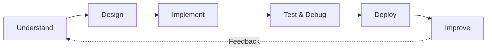
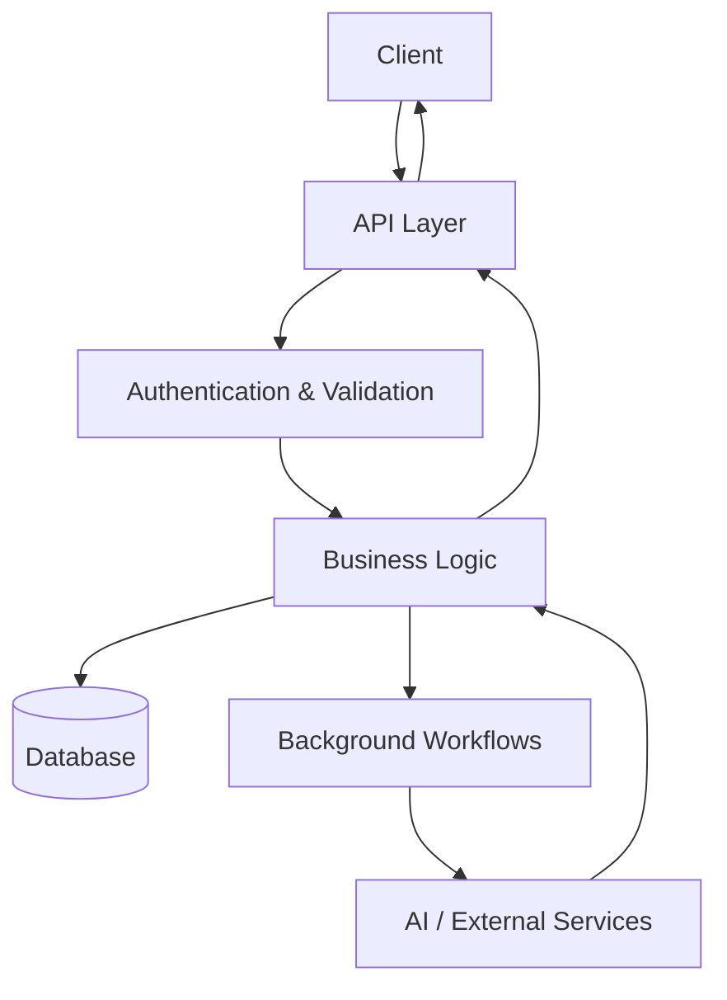

# Chirag Pandey

### Software Engineer · Backend Engineering · AI Engineering

I build practical software systems, design APIs, explore system architecture, and integrate AI into applications that solve real-world problems.

[](https://github.com/Chirag240105)
[](https://www.linkedin.com/in/chirag-pandey-b54499328/)

---

## Engineering Focus

```text
SOFTWARE ENGINEERING
│
├── Backend Systems
│   ├── REST APIs · Authentication · Databases
│   └── Architecture · Reliability · Security
│
├── Computer Science
│   ├── Data Structures & Algorithms
│   └── Operating Systems · Networking
│
└── AI Engineering
    ├── ML/DL · LLM Integration
    └── AI-powered Applications
```

## How I Build



I focus on maintainable code, clear API boundaries, sensible data models, and practical integration between application logic and AI services.

## Tech Stack

**Languages**


**Backend & APIs**


**Databases & Data**


**AI & Machine Learning**


**Tools & Deployment**


## Featured Projects

### [ImpactLens-AI](https://github.com/Chirag240105/ImpactLens-AI)

**AI-powered evidence intelligence and reporting**

Transforms field photos and videos into searchable, verifiable sustainability evidence and traceable reports.

- Modular client, API, and shared-configuration structure.
- AI-powered media analysis and semantic search.
- Media-integrity checks and traceable reporting.
- Backend workflows integrating databases, storage, and AI providers.

`React` `Node.js` `Express` `MongoDB` `LLM APIs`

[Repository](https://github.com/Chirag240105/ImpactLens-AI) · [Live Demo](https://impact-lens-ai-one.vercel.app/)

### [AgriSmart](https://github.com/Chirag240105/AgriSmart)

**Full-stack agricultural intelligence platform**

Connects agricultural workflows with machine learning, weather information, market insights, and AI-assisted guidance.

- Separate frontend, backend, and ML service.
- REST APIs with JWT-based authentication.
- Crop disease detection and market-price prediction.
- Integrations for weather information and AI assistance.

`React` `TypeScript` `Express` `MongoDB` `Python` `TensorFlow` `XGBoost`

[Repository](https://github.com/Chirag240105/AgriSmart) · [Live Demo](https://agri-smart-six-eta.vercel.app/)

### [Orbit AI Operating Layer](https://github.com/Chirag240105/orbit-ai-operating-layer)

**An evolving AI-powered personal assistant**

Explores a unified interface for AI-assisted workflows, contextual memory, agent-based capabilities, and interactive experiences.

- Focus on modular feature development.
- Exploration of contextual AI workflows.
- Emphasis on usability and extensibility.

`AI Agents` `LLM Integration` `Application Architecture`

[Explore Repository](https://github.com/Chirag240105/orbit-ai-operating-layer)

### [Admin Panel](https://github.com/Chirag240105/Admin-panel)

**Backend-oriented application development**

A separate project in my portfolio for exploring application structure and backend implementation.

[Explore Repository](https://github.com/Chirag240105/Admin-panel)

## Application Architecture

An illustrative architecture for the kinds of systems I explore—not a claim that every project uses these exact components.



## Currently Strengthening

- **Computer Science:** DSA in C++, operating systems, networking, and databases.
- **Backend Engineering:** API design, authentication, data modelling, and maintainable architecture.
- **System Design:** Scalability, distributed systems, caching, and reliability.
- **AI Engineering:** ML fundamentals, deep learning, LLM applications, and agent workflows.
- **Infrastructure:** Cloud fundamentals, Docker, deployment, and CI/CD.

## GitHub Activity

<p align="center">
  
  
</p>

*Statistics are generated by a third-party service and may occasionally be unavailable.*

## Let's Connect

Interested in collaborating on backend systems, developer tools, distributed applications, AI-powered software, and open-source projects.

- **GitHub:** [@Chirag240105](https://github.com/Chirag240105)
- **LinkedIn:** [Chirag Pandey](https://www.linkedin.com/in/chirag-pandey-b54499328/)

---

<p align="center">
  <sub>Building software with clear architecture, practical engineering, and continuous learning.</sub>
</p>
